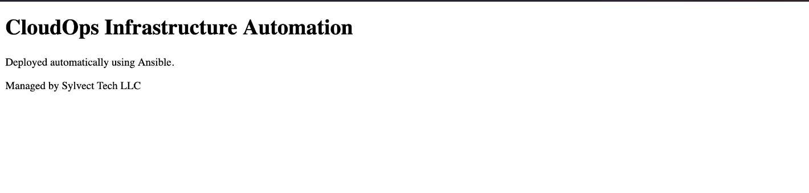
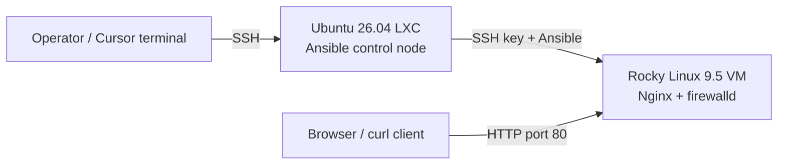

# Linux Infrastructure Automation | Ansible + Proxmox + Rocky Linux

**A working, repeatable Linux web-server deployment with verified SSH connectivity, firewall policy, HTTP response, and idempotency.**



> **Recruiter summary:** Built and validated an Ansible-controlled Linux deployment lab on Proxmox. A dedicated Ubuntu 26.04 controller remotely manages a Rocky Linux 9.5 VM over SSH. The playbook installs and enables Nginx, deploys a custom landing page, installs firewalld Python bindings, authorizes HTTP service access, and asserts the page is served correctly. The first deployment and subsequent no-change run are documented with real terminal evidence.

## Verified results

| Test | Recorded outcome |
| --- | --- |
| SSH + Ansible remote execution | `pong` from Rocky Linux node |
| Initial Nginx deployment | `ok=6 changed=3 failed=0` |
| Firewall configuration rollout | `ok=8 changed=1 failed=0` |
| Client HTTP test | HTTP/1.1 `200 OK`; expected HTML served |
| Subsequent idempotency run | **`ok=8 changed=0 unreachable=0 failed=0`** |

Evidence: [connectivity](evidence/01-ansible-ping.png) · [deployment](evidence/02-initial-deployment.png) · [firewall](evidence/03-firewall-automation.png) · [HTTP validation](evidence/04-http-validation.png) · [zero-change rerun](evidence/06-idempotency.png). See [evidence notes](docs/EVIDENCE.md) for what these screenshots establish and what they do not.

## Architecture



The lab used a private Proxmox network. Public samples deliberately use example addresses instead of exposing live LAN configuration. This is a single managed-node proof of concept, not a production fleet or cloud deployment.

## Repository layout

```text
.
├── README.md
├── ansible.cfg
├── .gitignore
├── requirements.yml
├── inventory/
│   └── hosts.ini.example
├── playbooks/
│   └── webserver.yml
├── docs/
│   ├── ARCHITECTURE.md
│   ├── DEPLOYMENT-SOP.md
│   ├── TROUBLESHOOTING.md
│   ├── EVIDENCE.md
│   └── SECURITY.md
└── evidence/
    └── 01-...png through 06-...png
```

## Reproduce

Use a disposable Rocky Linux 9 host with Python 3, SSH, and an `ansible` service account able to run `sudo`. From an Ansible-equipped controller:

```bash
ansible-galaxy collection install -r requirements.yml
cp inventory/hosts.ini.example inventory/hosts.ini
# Edit hosts.ini with the real managed host IP (private, ignored by Git).
ansible-inventory --graph
ansible linux_servers -m ping
ansible-playbook playbooks/webserver.yml --syntax-check
ansible-playbook playbooks/webserver.yml --ask-become-pass
ansible-playbook playbooks/webserver.yml --ask-become-pass
```

Run `curl -i http://<managed-host-ip>/` from a permitted client and verify a `200 OK` response and the expected page content. Full procedural details and acceptance criteria are in [Deployment SOP](docs/DEPLOYMENT-SOP.md).

## Skills demonstrated

Configuration management and idempotency · Linux package/service management · SSH key authentication · privilege escalation · firewall policy · HTTP health validation · virtualization-based test environments · debugging network/DNS issues · technical documentation.

## Scope and limitations

- Verified on **one** Rocky Linux target, not a fleet-wide rollout.
- Uses **HTTP** on a private lab network; no TLS or public production hardening is claimed.
- The public playbook is reconstructed from the validated steps shown in the session and must be checked against the live controller file before substituting it for the original source of truth.
- Historical validation screenshots are from **November 7, 2026**. Future runs should capture fresh evidence.

**Maintainer:** Sylvect Tech LLC / Infrastructure Automation Lab
**Project date:** November 2026

### Evidence provenance

Six curated proof screenshots appear under `evidence/`. A private timeline of all 31 original session screenshots is available in [`docs/SCREENSHOT-TIMELINE.md`](docs/SCREENSHOT-TIMELINE.md); full originals are excluded from Git with `.gitignore` due to private on-screen details.
