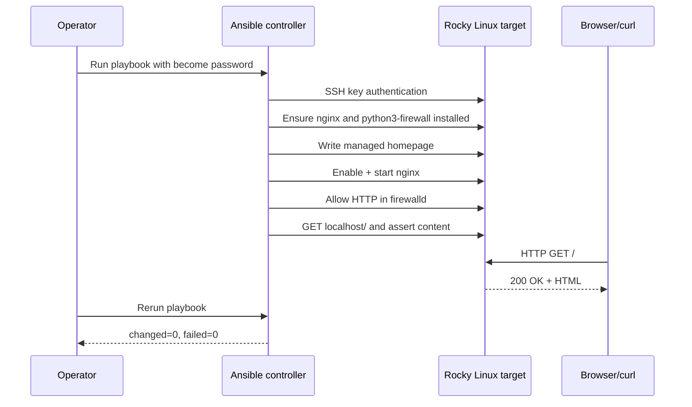

# Architecture and Design Decisions

## Components

| Layer | Real lab configuration (identifiers only) | Role |
| --- | --- | --- |
| Hypervisor | Proxmox VE host | Provides LXC/VM workloads |
| Control node | LXC 103, Ubuntu 26.04 | Runs Ansible from non-root service account |
| Target | Rocky Linux 9.5 guest | Receives SSH-based tasks and hosts Nginx |
| Management transport | OpenSSH with ED25519 key | Authenticated remote execution |
| Application | Nginx + static HTML | Demo service |
| Host firewall | firewalld | Allows HTTP via explicit service rule |
| Validation | Ansible `uri`, `assert`, external `curl` | Checks both local function and outside reachability |

## Deployment flow

## Why these choices

- **Ansible:** agentless, SSH-native, state-based tasks that can be rerun safely.
- **Proxmox:** lightweight reproducible lab foundation without cloud spend.
- **Key-based SSH:** reduces reliance on password-based remote administration. Ansible's `become` is still independently authorized.
- **firewalld service rule:** avoids turning off host firewall to make the demo work.
- **Local and external HTTP tests:** local success alone would not detect a firewall block for outside clients.

## Current bounds

This demonstration managed one Rocky VM and a single HTTP service; do not describe it as a multi-node production fleet, TLS deployment, or high-availability environment.
